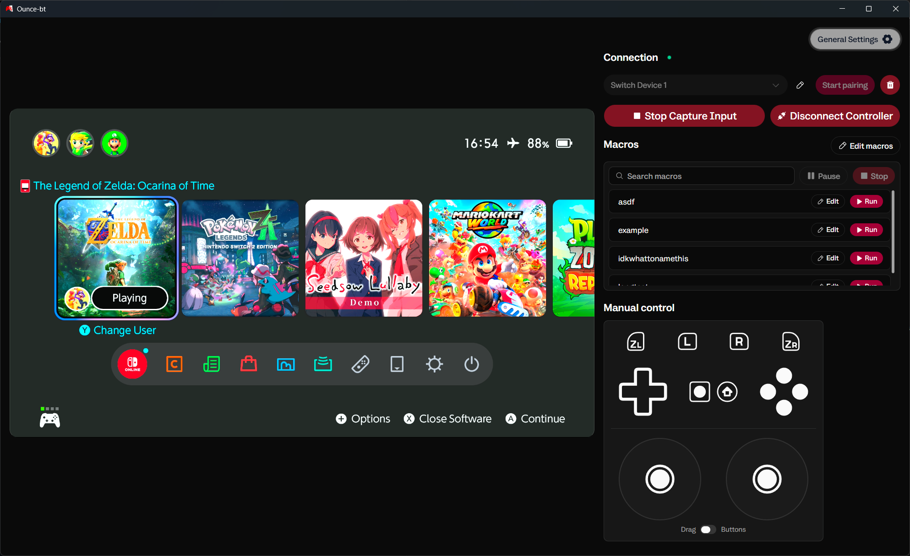
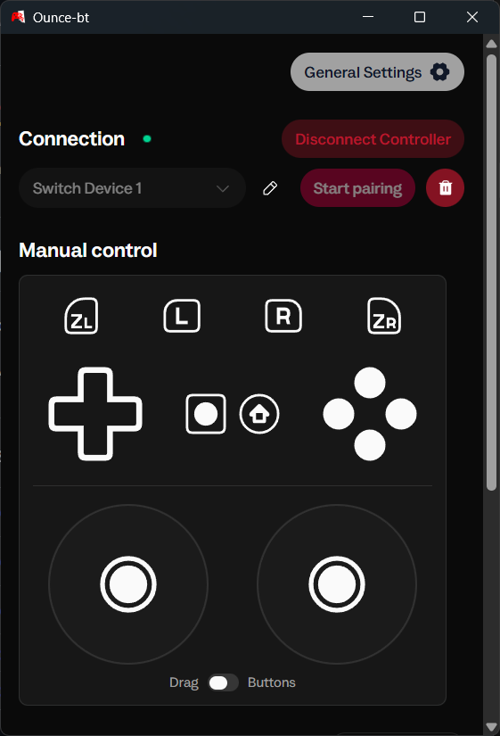
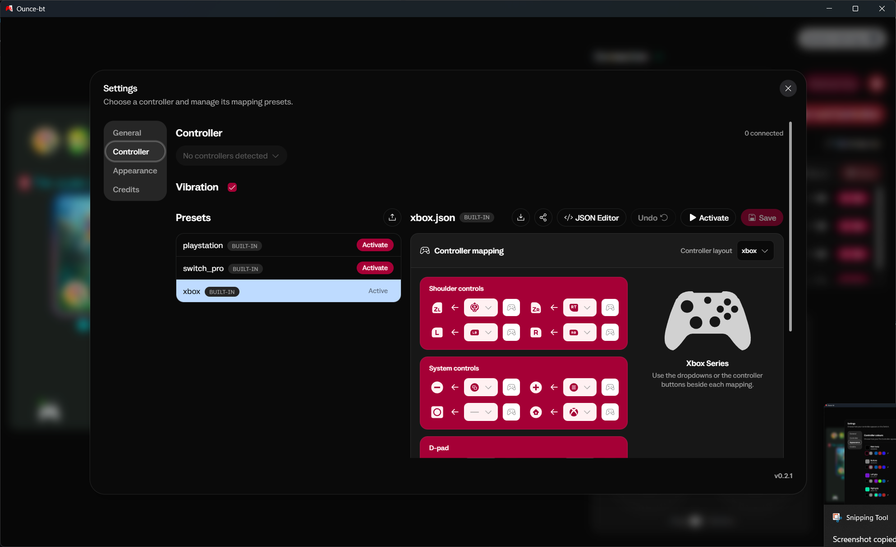
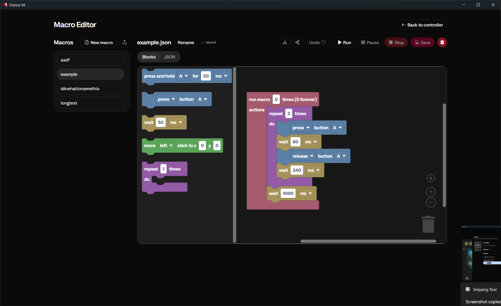
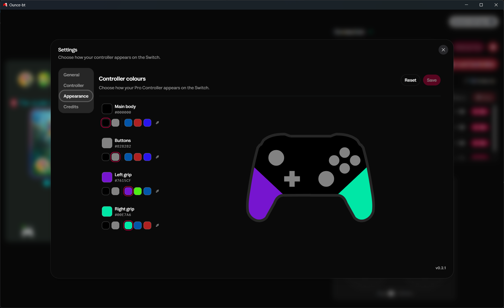

## Ounce-bt

<p float="left">
    
    
</p>
<p float="left">
  
  
  
</p>


### Configuration

In a source checkout, configuration is loaded from `config/config.json`.
If that file is absent, the app checks:

- Windows: `%APPDATA%/ounce-bt/config.json`
- Linux: `$XDG_CONFIG_HOME/ounce-bt/config.json`, defaulting to `~/.config/ounce-bt/config.json`

The Linux AppImage always uses the per-user configuration path.\
See [Linux setup and AppImage builds](docs/linux.md) for Linux specific changes.

### Zadig

On Windows, your bluetooth adapter needs to be adapted to WinUSB firmware.\
See [Instructions](https://google.github.io/bumble/platforms/windows.html)

### BT Firmware

Windows requires separately obtained `rtl8761bu_fw.bin` and
`rtl8761bu_config.bin` files beside the executable, or in the directory selected
with `--firmware-dir`.\
These are not distributed with Ounce-bt.\
If either file is missing, the frontend will notify you.

Linux uses the kernel's bundled firmware.
Download and extract the Linux release ZIP, then launch from its extracted folder:

```bash
./run-with-hci-caps.sh "$PWD/Ounce-bt-x86_64.AppImage" usb:0
```

#### Arguments

Settings can overridden for a single run with these command-line arguments.\
Run `uv run main.py --help` for the full help text.

| Argument                                             | Description                                                                      |
| ---------------------------------------------------- | -------------------------------------------------------------------------------- |
| `[device_config]`                                    | Optional Bumble device configuration JSON path.                                  |
| `[transport_spec]`                                   | Bluetooth transport, default `usb:0`. Can be supplied without `[device_config]`. |
| `[bt_address]`                                       | Optional Bluetooth address for the Realtek firmware patch.                       |
| `--input controller\|controller:<idx>\|macro:<path>` | Enable an input source; repeat to enable multiple sources.                       |
| `--web-host HOST`                                    | Web server bind host. Defaults to `127.0.0.1`.                                   |
| `--web-port PORT`                                    | Web server bind port. Defaults to `9127`.                                        |
| `--nolog`                                            | Disable logging for this run.                                                    |
| `--preset NAME\|PATH`                                | Controller mapping preset                                                        |
| `--firmware-dir PATH`                                | Windows: location of separately obtained Realtek firmware files.                 |

Command-line values override configuration for the current run and are not saved.

### Credits

This project includes code adapted from Brikwerk's [NXBT](https://github.com/Brikwerk/nxbt) project.

This project utilised typenoob's bumble implementation [(NXBT)](https://github.com/typenoob/nxbt) for help in understanding the pairing protocol.
Rumble decoding utilises dekuNukem's [Switch RE notes](https://github.com/dekuNukem/Nintendo_Switch_Reverse_Engineering)
